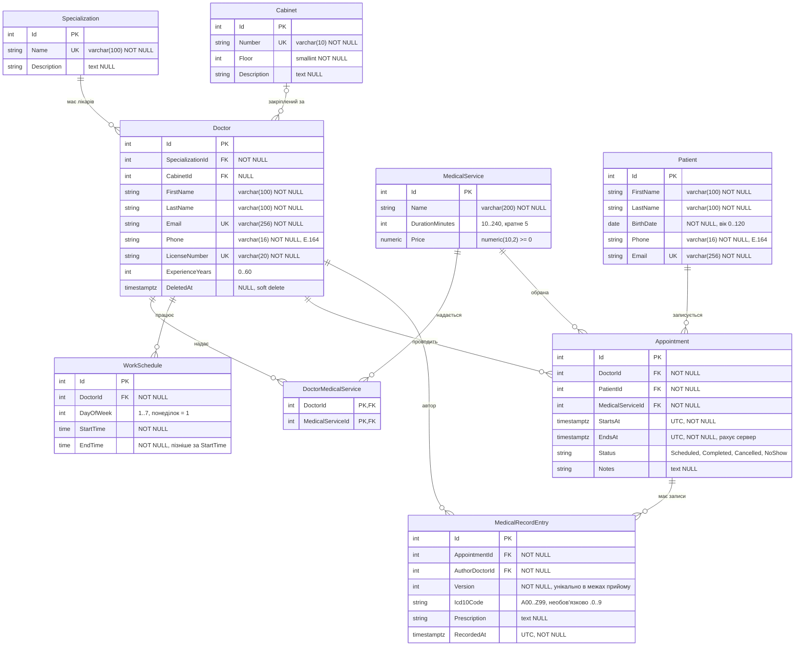

# ERD предметної області

Цільова модель Clinic Appointment API до міграцій EF Core. Джерела: [технічне завдання](TZ.md) (розділи 2.2–2.4), REST-контракти S2 (ідентифікатори `int`, імена полів з гілок спеціалізацій, лікарів і послуг) і зв'язки S4.

Діаграма охоплює сутності, які прямо названі в задачі (Specialization, Doctor, Patient, MedicalService, Cabinet), і сутності, без яких ці зв'язки не зберігаються в реляційній базі: таблицю M:N, графік, прийом і запис медичної картки.

## Діаграма

## Сутності

| Сутність | Поле | Тип | Обмеження |
|---|---|---|---|
| Specialization | Id | `integer` | PK |
| Specialization | Name | `varchar(100)` | NOT NULL, UNIQUE |
| Specialization | Description | `text` | NULL |
| Doctor | Id | `integer` | PK |
| Doctor | SpecializationId | `integer` | NOT NULL, FK |
| Doctor | CabinetId | `integer` | NULL, FK |
| Doctor | FirstName | `varchar(100)` | NOT NULL |
| Doctor | LastName | `varchar(100)` | NOT NULL |
| Doctor | Email | `varchar(256)` | NOT NULL, UNIQUE |
| Doctor | Phone | `varchar(16)` | NOT NULL, формат E.164: `^\+[1-9][0-9]{1,14}$` |
| Doctor | LicenseNumber | `varchar(20)` | NOT NULL, UNIQUE |
| Doctor | ExperienceYears | `integer` | NOT NULL, CHECK 0..60 |
| Doctor | DeletedAt | `timestamptz` | NULL; значення означає звільнення, рядок не видаляється |
| Cabinet | Id | `integer` | PK |
| Cabinet | Number | `varchar(10)` | NOT NULL, UNIQUE |
| Cabinet | Floor | `smallint` | NOT NULL |
| Cabinet | Description | `text` | NULL |
| Patient | Id | `integer` | PK |
| Patient | FirstName | `varchar(100)` | NOT NULL |
| Patient | LastName | `varchar(100)` | NOT NULL |
| Patient | BirthDate | `date` | NOT NULL; вік від 0 до 120 років перевіряє застосунок |
| Patient | Phone | `varchar(16)` | NOT NULL, той самий формат E.164 |
| Patient | Email | `varchar(256)` | NOT NULL, UNIQUE |
| MedicalService | Id | `integer` | PK |
| MedicalService | Name | `varchar(200)` | NOT NULL; унікальність не потрібна |
| MedicalService | DurationMinutes | `integer` | NOT NULL, CHECK від 10 до 240 і кратне 5 |
| MedicalService | Price | `numeric(10,2)` | NOT NULL, CHECK ≥ 0 |
| DoctorMedicalService | DoctorId | `integer` | PK, FK |
| DoctorMedicalService | MedicalServiceId | `integer` | PK, FK |
| WorkSchedule | Id | `integer` | PK |
| WorkSchedule | DoctorId | `integer` | NOT NULL, FK |
| WorkSchedule | DayOfWeek | `smallint` | NOT NULL, CHECK 1..7 (ISO-8601, понеділок = 1) |
| WorkSchedule | StartTime | `time` | NOT NULL, місцевий час клініки |
| WorkSchedule | EndTime | `time` | NOT NULL, CHECK пізніше за StartTime |
| Appointment | Id | `integer` | PK |
| Appointment | DoctorId | `integer` | NOT NULL, FK |
| Appointment | PatientId | `integer` | NOT NULL, FK |
| Appointment | MedicalServiceId | `integer` | NOT NULL, FK |
| Appointment | StartsAt | `timestamptz` | NOT NULL, UTC |
| Appointment | EndsAt | `timestamptz` | NOT NULL, UTC; обчислює сервер як початок плюс тривалість послуги |
| Appointment | Status | `text` | NOT NULL, CHECK: Scheduled, Completed, Cancelled, NoShow |
| Appointment | Notes | `text` | NULL |
| MedicalRecordEntry | Id | `integer` | PK |
| MedicalRecordEntry | AppointmentId | `integer` | NOT NULL, FK |
| MedicalRecordEntry | AuthorDoctorId | `integer` | NOT NULL, FK |
| MedicalRecordEntry | Version | `integer` | NOT NULL, UNIQUE (AppointmentId, Version) |
| MedicalRecordEntry | Icd10Code | `varchar(5)` | NOT NULL, CHECK `^[A-Z][0-9]{2}(\.[0-9])?$` |
| MedicalRecordEntry | Prescription | `text` | NULL |
| MedicalRecordEntry | RecordedAt | `timestamptz` | NOT NULL, UTC |

## Зв'язки

| Зв'язок | Кардинальність | Поведінка при видаленні |
|---|---|---|
| Specialization — Doctor | 1:N, лікар має рівно одну спеціалізацію | RESTRICT: спеціалізацію з лікарями видалити не можна |
| Cabinet — Doctor | 1:N, кабінет необов'язковий | SET NULL: після видалення кабінету лікар лишається без кабінету |
| Doctor — MedicalService | M:N через DoctorMedicalService | рядок зв'язку видаляється разом із лікарем (CASCADE); послугу, на яку вже є прийом, видалити не можна (RESTRICT) |
| Doctor — WorkSchedule | 1:N | CASCADE: інтервал не існує без лікаря |
| Doctor — Appointment | 1:N | RESTRICT |
| Patient — Appointment | 1:N | RESTRICT |
| MedicalService — Appointment | 1:N | RESTRICT |
| Appointment — MedicalRecordEntry | 1:N, кожна версія — окремий рядок | RESTRICT: прийом із карткою не видаляється |
| Doctor — MedicalRecordEntry | 1:N, лікар-автор | RESTRICT |

Прийом не є таблицею зв'язку M:N: у нього є власні початок, завершення, статус і примітки.

## Неочевидні рішення

1. **Ідентифікатори — `integer`.** Так уже зроблені контракти S2 (спеціалізації, лікарі, послуги). Окремий UUID не вводиться.
2. **Email і телефон лікаря обов'язкові.** У ТЗ email унікальний, телефон — E.164. У поточному in-memory DTO лікаря ці поля ще nullable; база фіксує NOT NULL, щоб унікальність email була повною, а не лише для непорожніх значень.
3. **Довжини, яких немає в ТЗ, узяті з контрактів S2.** LicenseNumber — 20 символів, назва послуги — 200. Імена людей і спеціалізації — 100, як у ТЗ для назви спеціалізації і як у DTO лікаря.
4. **Вік пацієнта не є колонкою і не є CHECK у базі.** Діапазон 0..120 залежить від поточної дати, а `CHECK` у PostgreSQL приймає лише immutable-вирази. Зберігається `BirthDate`, межу перевіряє сервіс.
5. **Оптимістична конкурентність пацієнта — через системну колонку `xmin`, без окремого поля.** ТЗ вимагає контроль конкурентного доступу під час зміни. EF Core може використати `xmin` як concurrency token.
6. **Soft delete лише в лікаря.** `DeletedAt` замість фізичного видалення. Інші довідники видаляються фізично, з правилами RESTRICT / SET NULL вище. Звільнений лікар зникає з пошуку, але його прийоми і записи картки лишаються.
7. **M:N без сурогатного ключа.** У `DoctorMedicalService` немає власних атрибутів, тому первинний ключ складений з двох FK.
8. **Графік — локальний час, прийом — UTC.** `StartTime` / `EndTime` мають тип `time` без часового поясу: це стінний годинник клініки. Пояс один на всю клініку і лежить у конфігурації, не в таблиці. Слоти під час генерації переводяться в `timestamptz`. Інтервали одного лікаря в один день не перетинаються; це exclusion constraint, а не звичайний UNIQUE, бо заборонений саме перетин, а не лише рівні межі.
9. **Подвійний запис закриває база.** Для лікаря і окремо для пацієнта — exclusion constraint на `tstzrange(StartsAt, EndsAt, '[)')`. Умова часткова: статус не `Cancelled`, бо скасований прийом слот звільняє. `NoShow` і `Completed` інтервал і далі займають.
10. **Кабінет у прийом не копіюється.** Місце прийому — поточний `Doctor.CabinetId`. Якщо лікар змінить кабінет, старі прийоми покажуть новий. Окремий `Appointment.CabinetId` має сенс лише якщо потрібен знімок кабінету на момент запису.
11. **Автор запису картки збігається з лікарем прийому.** `AuthorDoctorId` зберігається в рядку версії, але сервіс приймає запис лише від `Appointment.DoctorId` і лише коли статус уже `Completed`. Нове редагування додає рядок із наступним `Version`, попередні рядки не змінюються.
12. **Дозволені переходи статусу прийому:** Scheduled → Completed, Scheduled → Cancelled, Scheduled → NoShow. Інші переходи заборонені в сервісі; CHECK тримає лише множину значень.

## Поза цією діаграмою

Обліковий запис, роль і JWT (S7), файл результату аналізу (S8) і колонки аудиту (S4) сюди не входять. Їх додають окремим оновленням цього файлу в тій задачі, яка змінює модель.
